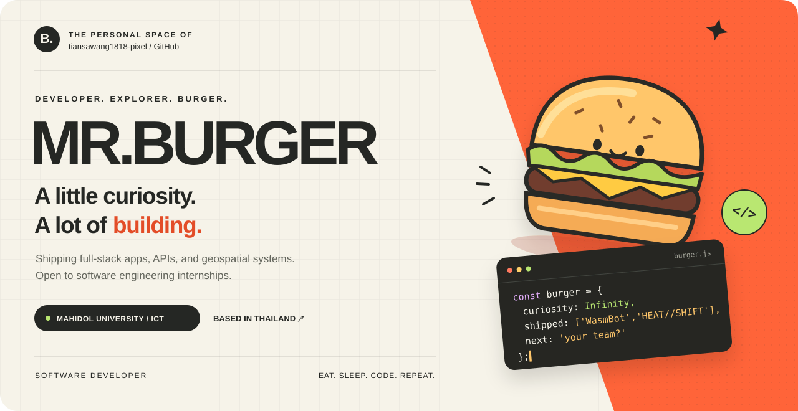
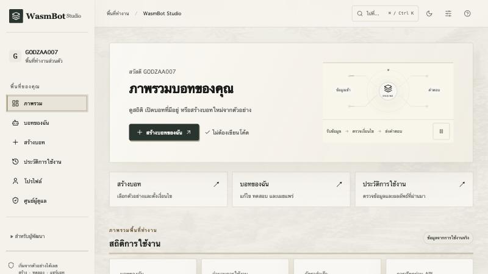
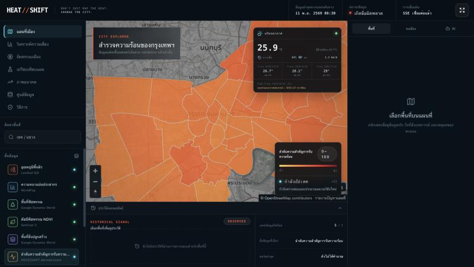

  

  
  
  
  

  

  <a href="#a-person-before-a-profile">THE PERSON</a> &nbsp; / &nbsp;
  <a href="#fresh-off-the-grill">THE WORK</a> &nbsp; / &nbsp;
  <a href="#whats-in-my-kitchen">THE TOOLKIT</a> &nbsp; / &nbsp;
  <a href="#the-commit-trail">THE ACTIVITY</a>

 

## A person before a profile.

Hey, I’m **MR.Burger** 🍔 — **Tiansawang Suetrong**, a Digital Science and Technology student at the **Faculty of ICT, Mahidol University**, Thailand.

I like owning the whole system: the interface people touch, the API in the middle, and the data model underneath. Lately that has meant a no-code bot platform running on **Rust WebAssembly** and a map-first **geospatial** platform for Bangkok’s urban heat.

  

 

## Fresh off the grill.

Two real products, both live. Click through and try them.

<table>
  <tr>
    <td width="50%" valign="top">
      
      <h3>🤖 WasmBot Studio</h3>
      
A no-code platform that turns business rules into reusable bots: design rules visually, test them on a Rust WebAssembly engine, publish immutable versions, then use them through a hosted form, embed, REST API, or SDK.

      <ul>
        <li>Nested AND/OR rule editor with <b>12 operators</b></li>
        <li>Row-level security, scoped API keys (HMAC-SHA256), rate limits</li>
        <li><b>7 Supabase Edge Functions</b> around a Rust → WASM engine</li>
      </ul>
      

        
      

      

        <a href="https://wasmbot-studio.vercel.app/"><b>Open live app ↗</b></a> &nbsp;·&nbsp;
        <a href="https://github.com/tiansawang1818-pixel/wasmbot-studio">Source code ↗</a>
      

    </td>
    <td width="50%" valign="top">
      
      <h3>🔥 HEAT//SHIFT</h3>
      
A map-first decision platform for planning urban heat mitigation in Bangkok, built on real satellite, weather, population, and OpenStreetMap data, with every number traceable to a dataset version.

      <ul>
        <li><b>6-stage pipeline</b>: staging → validation → processing → publishing → cache → live client updates</li>
        <li>Versioned PostGIS data for all <b>50 Bangkok districts</b></li>
        <li>City Optimizer with OR-Tools and evidence-gated investment candidates</li>
      </ul>
      

        
      

      

        <a href="https://heatshift.hostless.app/"><b>Open live app ↗</b></a> &nbsp;·&nbsp;
        <a href="https://github.com/tiansawang1818-pixel/HEAT">Source code ↗</a>
      

    </td>
  </tr>
</table>

  More practice and coursework in my <a href="https://github.com/tiansawang1818-pixel?tab=repositories">repositories</a>, including <a href="https://github.com/tiansawang1818-pixel/HTML101">HTML101</a> (web fundamentals).

 

## What’s in my kitchen?

Different ingredients. Plenty of things to build.

| | Ingredients |
| :--- | :--- |
| **The foundations** | Python · JavaScript · Java · SQL |
| **What you see** | HTML · CSS · JavaScript |
| **Behind the scenes** | Node.js · Express.js · MySQL |
| **On the workbench** | Git · GitHub · VS Code · Linux · Postman · npm |

   
  

 

## A few things I’m curious about.

**01 / WEB & SOFTWARE** 
Designing systems that fit together, from the database schema to the button people click.

**02 / DATA & GEOSPATIAL** 
Turning messy, real-world data into versioned, trustworthy decisions on a map.

**03 / AI & NETWORKS** 
Exploring intelligent applications and how devices communicate under the hood.

 

> “Great software starts with curiosity, creativity, and the courage to build.”

 

## The commit trail.

Small steps, experiments, and things learned along the way.

  
  

<picture>
  <source media="(prefers-color-scheme: dark)" srcset="https://raw.githubusercontent.com/tiansawang1818-pixel/tiansawang1818-pixel/output/github-contribution-grid-snake-dark.svg" />
  <source media="(prefers-color-scheme: light)" srcset="https://raw.githubusercontent.com/tiansawang1818-pixel/tiansawang1818-pixel/output/github-contribution-grid-snake.svg" />
  
</picture>

 

---

  <b>That’s me. Still learning. Still cooking. 🍔</b> 
  MR.Burger · Tiansawang Suetrong · ICT, Mahidol University · Thailand  
  <a href="https://tiansawang1818-pixel.github.io/">See the full portfolio ↗</a> &nbsp;·&nbsp;
  <a href="mailto:tiansawang1818@gmail.com">Let’s build something together ↗</a>

